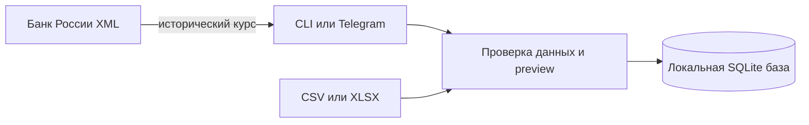

# Money Radar

Локальный журнал расходов с Decimal-арифметикой, бюджетами и preview перед импортом выписок. CSV/XLSX разбираются на этом компьютере; банковские данные не отправляются сторонним сервисам.

[](https://github.com/jezannn16/money-radar/actions/workflows/ci.yml)

**Навигация:** [Возможности](#возможности) · [Установка](#установка) · [Примеры](#примеры) · [Исторические курсы](#исторические-курсы) · [Проверки](#проверки) · [Безопасность и ограничения](#безопасность-и-ограничения)

## Возможности

- Ручное добавление расходов, месячные отчёты и бюджеты по категориям.
- Импорт CSV/XLSX с сопоставлением колонок, построчными ошибками и предварительным просмотром. Запись происходит только при `--confirm`.
- Повторный импорт файла распознаётся; операции дедуплицируются по внешнему ID или по дате, сумме, валюте и merchant.
- CSV export и удаление записей выбранного пользователя.
- Опциональный Telegram ввод с allowlist и подтверждением новой операции.
- Исторические курсы валют запрашиваются у публичного XML интерфейса Банка России; для RUB курс равен 1.



## Установка

Нужны Python 3.11+ и [uv](https://docs.astral.sh/uv/).

```sh
uv sync --extra dev
uv run money-radar --help
```

По умолчанию CLI создаёт `money_radar.sqlite3` в текущей папке. Для другого пути передайте `--db PATH` перед командой.

## Примеры

```sh
uv run money-radar --db demo.sqlite3 add 350 RUB coffee --category Food --user 42
uv run money-radar --db demo.sqlite3 budget 2026-10 Food 10000 RUB --user 42
uv run money-radar --db demo.sqlite3 month 2026-10 --user 42
uv run money-radar --db demo.sqlite3 rate USD --date 2025-01-15
```

Импорт сначала только показывает preview:

```sh
uv run money-radar --db demo.sqlite3 import statement.csv --user 42 \
  --map date=Date --map amount=Amount --map currency=Currency \
  --map merchant=Merchant --map category=Category
```

После проверки строк повторите команду с `--confirm`, чтобы записать их. Для проверки используйте синтетический файл и временную базу. См. [демо-сценарий](docs/demo.md).

## Исторические курсы

При `rate USD --date YYYY-MM-DD` Money Radar получает код валюты из дневного XML ответа ЦБ, затем запрашивает динамический курс за указанную дату. Значение относится к единице валюты после деления на `Nominal`. Если данных на дату нет, команда сообщает об этом и не подставляет текущий курс.

## Проверки

```sh
uv run pytest
uv run ruff check src tests
```

По умолчанию тесты используют синтетические данные и подменённый HTTP транспорт. Опциональную реальную проверку публичного XML интерфейса ЦБ можно запустить отдельно:

```sh
RUN_LIVE_TESTS=1 uv run pytest -m live
```

Live тест выполняет только чтение курса USD на фиксированную историческую дату; данные приложения не меняются. GitHub Actions запускает unit-тесты и Ruff на Python 3.11 и 3.12 без сетевых интеграционных тестов.

## Безопасность и ограничения

Для Telegram задайте локально `TELEGRAM_BOT_TOKEN` и `ALLOWED_USER_IDS` в `.env`; секреты не коммитьте. CLI `--user` — это фильтр данных, а не механизм аутентификации. Используйте базу только на доверенном компьютере.

Валюта — трёхбуквенный код; отчёты не конвертируют разные валюты друг в друга. Автоматического расписания recurring расходов и резервного копирования пока нет. Импорт читает CSV UTF-8 и первый лист XLSX.
