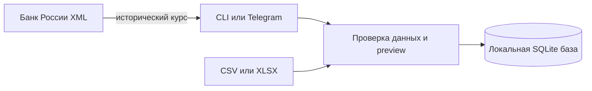

# Money Radar


Локальный журнал расходов с Decimal-арифметикой, бюджетами и preview перед импортом выписок. CSV/XLSX разбираются на этом компьютере; банковские данные не отправляются сторонним сервисам.

[](https://github.com/jezannn16/money-radar/actions/workflows/ci.yml)

**Навигация:** [Возможности](#возможности) · [Установка](#установка) · [Примеры](#примеры) · [Исторические курсы](#исторические-курсы) · [Проверки](#проверки) · [Безопасность и ограничения](#безопасность-и-ограничения)

## Возможности

- Ручное добавление расходов, месячные отчёты и бюджеты по категориям.
- Ежемесячные recurring rules можно создавать, просматривать, отключать и применять к конкретному месяцу; период применяется идемпотентно.
- Объяснимые кандидаты на необычные расходы: текущая сумма сравнивается с медианой прошлых расходов той же категории и валюты.
- Импорт CSV/XLSX с сопоставлением колонок, построчными ошибками и предварительным просмотром. Запись происходит только при `--confirm`.
- Повторный импорт файла распознаётся; операции дедуплицируются по внешнему ID или по дате, сумме, валюте и merchant.
- CSV export и удаление записей выбранного пользователя.
- Консистентная SQLite backup-копия без перезаписи существующего файла.
- Опциональный Telegram ввод командой `/add ...` или обычным текстом (`кофе 350 RUB`, `такси 780`) с preview и подтверждением; валюта по умолчанию RUB, подтвердить/отменить preview может только его автор.
- Исторические курсы валют запрашиваются у публичного XML интерфейса Банка России; для RUB курс равен 1.



## Установка

Нужны Python 3.11+ и [uv](https://docs.astral.sh/uv/).

```sh
uv sync --extra dev
uv run money-radar --help
```

По умолчанию CLI создаёт `money_radar.sqlite3` в текущей папке. Для другого пути передайте `--db PATH` перед командой.

## Примеры

```sh
uv run money-radar --db demo.sqlite3 add 350 RUB coffee --category Food --user 42
uv run money-radar --db demo.sqlite3 budget 2026-10 Food 10000 RUB --user 42
uv run money-radar --db demo.sqlite3 month 2026-10 --user 42
uv run money-radar --db demo.sqlite3 unusual 2026-10 --user 42
uv run money-radar --db demo.sqlite3 recurring-add rent Home 50000 RUB --day 1 --user 42
uv run money-radar --db demo.sqlite3 recurring-run 2026-10 --user 42
uv run money-radar --db demo.sqlite3 rate USD --date 2025-01-15
uv run money-radar --db demo.sqlite3 category-add Food --user 42
uv run money-radar --db demo.sqlite3 categories --user 42
uv run money-radar --db demo.sqlite3 filter --from 2026-10-01 --to 2026-10-31 --category Food --user 42
uv run money-radar --db demo.sqlite3 backup backups/demo.sqlite3
```

Импорт CSV/XLSX (первый лист) сначала только показывает preview:

```sh
uv run money-radar --db demo.sqlite3 import statement.csv --user 42 \
  --map date=Date --map amount=Amount --map currency=Currency \
  --map merchant=Merchant --map category=Category
```

После проверки строк повторите команду с `--confirm`, чтобы записать их. Для проверки используйте синтетический файл и временную базу. См. [демо-сценарий](docs/demo.md).

Дубликат определяется по внешнему ID банковской строки, если он задан; иначе применяется fingerprint `date + amount + currency + merchant`. Поэтому две одинаковые по этим полям покупки без внешних ID считаются неразличимыми и одна будет пропущена, а разные внешние ID сохраняют похожие покупки. Повторный импорт того же файла дополнительно распознаётся по hash пакета.

Сумма расхода хранится положительной как `Decimal` с точностью до 0.01; ввод с большей точностью округляется через `ROUND_HALF_EVEN`. Дата проводки хранится календарной датой без времени и timezone, поскольку CSV-выписки обычно содержат дату, а не точный момент.

Recurring rules применяются явно командой `recurring-run YYYY-MM` или Telegram-командой `/recurring-run YYYY-MM`. Уникальная пара rule/month предотвращает повторное создание при повторном запуске; указанное число месяца ограничивается последним днём месяца (например, 31 января → 28 февраля). Проект не запускает фоновый месячный scheduler.

## Исторические курсы

При `rate USD --date YYYY-MM-DD` Money Radar получает код валюты из дневного XML ответа ЦБ, затем запрашивает динамический курс за указанную дату. Значение относится к единице валюты после деления на `Nominal`. Если данных на дату нет, команда сообщает об этом и не подставляет текущий курс.
Успешные ответы кэшируются в таблице приложения по валюте и запрошенной дате, включая фактическую дату курса; кэш переживает перезапуск.

## Проверки

```sh
uv run pytest
uv run ruff check src tests
```

По умолчанию тесты используют синтетические данные и подменённый HTTP транспорт. Опциональную реальную проверку публичного XML интерфейса ЦБ можно запустить отдельно:

```sh
RUN_LIVE_TESTS=1 uv run pytest -m live
```

Live тест выполняет только чтение курса USD на фиксированную историческую дату; данные приложения не меняются. GitHub Actions запускает unit-тесты и Ruff на Python 3.11 и 3.12 без сетевых интеграционных тестов.

## Безопасность и ограничения

Для Telegram задайте локально `TELEGRAM_BOT_TOKEN` и `ALLOWED_USER_IDS` в `.env`; секреты не коммитьте. Бот строго работает только в личном чате: ответы и preview в группах блокируются, callback-подтверждения принимаются лишь из private chat и от разрешённого владельца preview. SQLite база и существующие sidecar-файлы создаются с правами владельца (`0600`). CLI `--user` — это фильтр данных, а не механизм аутентификации. Используйте базу только на доверенном компьютере.

Валюта — трёхбуквенный ASCII-код; отчёты не конвертируют разные валюты друг в друга. CSV export экранирует текстовые поля, начинающиеся с символов формулы таблиц, добавляя апостроф; это предотвращает их выполнение в spreadsheet-программах, но такое представление рассчитано на просмотр и не является побайтно точной копией исходных текстовых полей при повторном импорте. `/unusual YYYY-MM` и `unusual YYYY-MM --user ID` используют медиану шести предыдущих месяцев, минимум пять наблюдений и порог ×3; это только сигнал для ручной проверки, не финансовый вывод. Backup создаётся вручную командой `backup PATH`; путь должен быть новым и файл ограничен правами владельца. Импорт читает CSV UTF-8 и первый лист XLSX.
